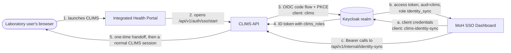

# SSO and identity sync onboarding

Start here if you are connecting CLIMS to the Ministry of Health Keycloak
realm, the Integrated Health Portal, or the MoH SSO Dashboard. This page says
who does what, which credentials exist and where each one lives. The exact
settings, sign-in flow and endpoint behaviour are in the
[SSO runbook](../infra/sso/README.md).

## 1. How the systems fit together



There are two separate connections.

- **Sign-in (steps 1–5).** A user starts CLIMS from the portal. Keycloak
  reuses their existing login, and CLIMS checks two things: the user holds
  `clims_access`, and their Keycloak identity is linked to an active CLIMS
  account with a role. CLIMS then starts an ordinary CLIMS session for that
  account through a 60-second, single-use handoff.
- **Identity sync (steps a–c).** The dashboard calls CLIMS server to server.
  It lists CLIMS accounts, links each one to a Keycloak identity, and ends
  sessions when it removes someone's access. CLIMS verifies the dashboard's
  token against Keycloak's public keys, so the two systems never exchange a
  secret.

Keycloak proves who the user is. CLIMS still decides what they can do, using
the roles, permissions and facility assignment of the linked account. A
Keycloak role alone never grants data access, and email is never used to find
an account.

## 2. Who does what

| Team                   | Responsibility                                                                        | Steps                        |
| ---------------------- | ------------------------------------------------------------------------------------- | ---------------------------- |
| Keycloak administrator | Creates or imports both clients, assigns roles                                        | Section 4 and runbook step 1 |
| Portal administrator   | Imports `clims.application.yaml`, activates CLIMS, assigns the access role            | Runbook step 2               |
| CLIMS operator         | Applies migrations, sets `infra/env/prod.env`, restarts                               | Runbook "Portal sign-in"     |
| Dashboard team         | Registers CLIMS, stores the `clims-identity-sync` credentials, runs the reviewed sync | Section 6 below              |
| CLIMS developer        | Runs portal sign-in locally when changing auth code                                   | Section 7 below              |

## 3. Credentials map

| Credential                                      | Created by                             | Stored in                                                | Used by                                       | Never give to                   |
| ----------------------------------------------- | -------------------------------------- | -------------------------------------------------------- | --------------------------------------------- | ------------------------------- |
| `clims` client secret (`OIDC_CLIENT_SECRET`)    | Keycloak, or preset in the import file | CLIMS `infra/env/prod.env`                               | CLIMS, to redeem sign-in codes                | Dashboard, portal, browsers     |
| `JWT_SECRET`                                    | CLIMS operator                         | CLIMS `infra/env/prod.env`                               | CLIMS, to sign its tokens and the SSO handoff | Anyone else, including Keycloak |
| `clims-identity-sync` client secret             | Keycloak, or preset in the import file | Dashboard secret store (`CLIMS_SYNC_CLIENT_SECRET_FILE`) | Dashboard, to obtain access tokens            | CLIMS (it doesn't need it)      |
| `DB_PASSWORD`, `S3_ACCESS_KEY`, `S3_SECRET_KEY` | CLIMS operator                         | CLIMS `infra/env/prod.env`                               | CLIMS and its services                        | Anyone else                     |

`IDENTITY_SYNC_CLIENT_ID=clims-identity-sync` is a client ID, not a secret.

### Generating secrets without displaying them

Generate secrets straight into the file that uses them so they never appear on
screen or in shell history:

```sh
umask 077
printf 'JWT_SECRET=%s\n' "$(openssl rand -base64 64 | tr -d '\n/+=' | cut -c1-64)" >> infra/env/prod.env
```

Remove the empty `JWT_SECRET=` line from the copied template afterwards.

To choose a Keycloak client secret before importing, copy the client file to a
`*.secret.json` name, set its `"secret"` field from `openssl rand`, and import
that copy. `*.secret.json` and `*.dashboard.env` files under `infra/sso/` hold
real secrets: they are ignored by git, keep them readable only by you
(`chmod 600`), and delete them after import. The alternative is to let
Keycloak generate the secret and copy it from the client's Credentials tab.

### Rotating

| Credential                   | How                                                                                                          | Effect                                                                                      |
| ---------------------------- | ------------------------------------------------------------------------------------------------------------ | ------------------------------------------------------------------------------------------- |
| `clims` client secret        | Keycloak → Clients → `clims` → Credentials → Regenerate; update `OIDC_CLIENT_SECRET`; restart CLIMS          | Portal sign-ins fail between the two steps; password sign-in and existing sessions continue |
| `JWT_SECRET`                 | Replace in `infra/env/prod.env`; restart CLIMS                                                               | Tokens signed with the old secret stop working; plan it as a sign-out of everyone           |
| `clims-identity-sync` secret | Keycloak → Clients → `clims-identity-sync` → Credentials → Regenerate; update the dashboard's mounted secret | Sync calls fail until the dashboard has the new secret                                      |

## 4. Keycloak clients and files

A realm created from the dashboard's `infra/keycloak/realm-export.json` already
contains `clims`, `clims-identity-sync`, both client roles, the scope mapping
and the service-account role. For that realm, only regenerate the two secrets.
For any other realm, use the files below. They are copied from that reference
export with `https://clims.example.org` in place of the real host.

| File                                                                                                        | Tracked | Purpose                                                                                                                |
| ----------------------------------------------------------------------------------------------------------- | ------- | ---------------------------------------------------------------------------------------------------------------------- |
| [infra/sso/README.md](../infra/sso/README.md)                                                               | Yes     | Runbook: settings, sign-in flow, refusal reasons, identity-sync endpoints                                              |
| [infra/sso/clims.keycloak-client.json](../infra/sso/clims.keycloak-client.json)                             | Yes     | `clims` client for Clients → Import client. No secret                                                                  |
| [infra/sso/clims-identity-sync.keycloak-import.json](../infra/sso/clims-identity-sync.keycloak-import.json) | Yes     | Partial import: `clims_access` and `identity_sync` roles, `clims-identity-sync` client with audience mapper. No secret |
| [infra/sso/clims.application.yaml](../infra/sso/clims.application.yaml)                                     | Yes     | Portal registry manifest for Systems → Import manifest                                                                 |
| `infra/sso/*.secret.json`, `infra/sso/*.dashboard.env`                                                      | No      | Local copies holding real secrets                                                                                      |
| [infra/env/prod.env.example](../infra/env/prod.env.example)                                                 | Yes     | Template for `infra/env/prod.env`                                                                                      |
| `backend/internal/database/migrations/000014_user_oidc_identities.*`, `000036_session_revocation_marker.*`  | Yes     | Account links and the revocation marker                                                                                |

To import into a realm that wasn't built from the reference export:

1. Replace `https://clims.example.org` with the CLIMS origin in
   `clims.keycloak-client.json`, then Clients → Import client.
2. Realm settings → Action → Partial import →
   `clims-identity-sync.keycloak-import.json`. This creates the client roles on
   `clims` and the `clims-identity-sync` client.
3. Clients → `clims-identity-sync` → Service account roles → Assign role →
   `clims` → `identity_sync`.
4. `fullScopeAllowed` is off on the sync client, so the role reaches its token
   only through a scope mapping, which partial import can't carry: Clients →
   `clims-identity-sync` → Client scopes → `clims-identity-sync-dedicated` →
   Scope → Assign role → `clims` → `identity_sync`. Without it every sync call
   gets 403.

## 5. Which CLIMS clients work with portal sign-in

Unlike some applications, CLIMS keeps password sign-in when portal sign-in is
on. Setting `OIDC_CLIENT_ID` adds the portal routes; it doesn't remove anything.

| Client                  | Password sign-in | Portal sign-in                                                            |
| ----------------------- | ---------------- | ------------------------------------------------------------------------- |
| Web app (`frontend/`)   | Works            | Works: `/sso/complete` redeems the handoff at `/api/v1/auth/sso/exchange` |
| Mobile app (`mobile/`)  | Works            | Not offered; the app uses `POST /auth/login`                              |
| Dashboard identity sync | Not applicable   | Works when `IDENTITY_SYNC_CLIENT_ID` is set and the issuer is HTTPS       |

A session from either path belongs to the same CLIMS account, with the same
roles and facility assignment, and `POST /sessions/revoke` ends both kinds.

## 6. For the dashboard team

The dashboard repository documents its side in
`docs/integrations/connected-applications.md` and the first production links
in `docs/operations/identity-sync-pilot.md`, which uses CLIMS as its example.

| Value                        | Example                                                   |
| ---------------------------- | --------------------------------------------------------- |
| Origin (registry `--origin`) | `https://clims.health.go.ug`                              |
| Sync client                  | `clims-identity-sync`                                     |
| Access role                  | `clims_access`                                            |
| Client secret                | From Keycloak, mounted as `CLIMS_SYNC_CLIENT_SECRET_FILE` |
| Account ID format            | `uuid` (from CLIMS's descriptor)                          |
| Contract                     | 1.1                                                       |

`issuer` in every link must equal CLIMS's `OIDC_ISSUER` exactly. The CLIMS
operator confirms `/api/v1/internal/identity-sync` is reachable from the
dashboard's network and, if the proxy allows it, not from the internet.

## 7. Running portal sign-in locally (developers)

1. Run a Keycloak realm you control, for example the dashboard's local stack,
   whose realm export already has the CLIMS clients. Point their redirect URI
   at your local CLIMS origin.
2. Set `OIDC_ISSUER`, `OIDC_CLIENT_ID=clims`, `OIDC_CLIENT_SECRET` and
   `OIDC_PUBLIC_ORIGIN` in `infra/env/dev.env`. HTTP is accepted only for
   loopback origins.
3. To test sync, also set `IDENTITY_SYNC_CLIENT_ID=clims-identity-sync`. The
   sync endpoints require an HTTPS issuer.
4. For the dashboard's conformance suite, also set `APP_ENV=test` (or
   `development`) and `IDENTITY_SYNC_TEST_PROBE=1`. CLIMS refuses to start with
   the probe in production, and an unset `APP_ENV` counts as production.
5. Use the Playwright helpers in `frontend/dev/sso-browser-checks/` described
   in the runbook.

The dashboard's `make -C infra identity-sync-e2e-test` runs CLIMS, Poesgo,
Keycloak and the dashboard together and is the reference end-to-end check.

Code lives in `backend/internal/features/auth/sso.go` (sign-in and handoff)
and `identity_sync.go` (dashboard API), wired up in
`backend/cmd/server/main.go`. Configuration is read in
`backend/internal/config/config.go`.

## 8. Troubleshooting

For step-by-step diagnosis in production, and for creating or rebuilding the
`clims` client after it was deleted, see
[SSO troubleshooting and client recovery](sso-troubleshooting.md).

| Symptom                                                                                             | Likely cause                                                                                                                                                |
| --------------------------------------------------------------------------------------------------- | ----------------------------------------------------------------------------------------------------------------------------------------------------------- |
| CLIMS exits with "configure OIDC_ISSUER, OIDC_CLIENT_ID, OIDC_CLIENT_SECRET and OIDC_PUBLIC_ORIGIN" | One of them empty while `OIDC_CLIENT_ID` is set, or `OIDC_PUBLIC_ORIGIN` has a path or trailing slash, or a URL uses HTTP outside loopback                  |
| CLIMS refuses to start with `IDENTITY_SYNC_TEST_PROBE`                                              | It is set while `APP_ENV` is unset or `production`, has a value other than `1`, or `IDENTITY_SYNC_CLIENT_ID` is empty                                       |
| Keycloak shows "Invalid redirect uri"                                                               | The `clims` redirect URI doesn't exactly match `<OIDC_PUBLIC_ORIGIN>/api/v1/auth/sso/callback`                                                              |
| Sign-in page shows `sso_error=denied`                                                               | No `clims_access`, token issued to another client, or access removed (revoke) after the token was issued                                                    |
| `sso_error=unavailable`                                                                             | Identity not linked, or the linked account is disabled or has no role                                                                                       |
| `sso_error=invalid`                                                                                 | Stale tab, or sign-in not started from the portal                                                                                                           |
| `sso_error=failed`                                                                                  | Keycloak or the database unreachable, or a wrong `OIDC_CLIENT_SECRET`                                                                                       |
| `sso_error=expired`                                                                                 | Handoff older than 60 seconds or already used                                                                                                               |
| Identity-sync returns 404 for every path                                                            | `IDENTITY_SYNC_CLIENT_ID` is empty, so the routes are off                                                                                                   |
| Identity-sync returns 401                                                                           | Token expired, from another issuer, or `aud` lacks `clims` (check the audience mapper)                                                                      |
| Identity-sync returns 403                                                                           | Token not from `clims-identity-sync` (`azp`), its service account lacks `clims` → `identity_sync`, or the role is missing from the client's dedicated scope |
| Identity-sync `PUT` returns 409                                                                     | The account is already linked. Links are never replaced through the API                                                                                     |
